<!-- Generated by scripts/render_cards.py. Edit profile.json to customize. -->

### Selected work

---

[Explore my repositories](https://github.com/tot-nekit?tab=repositories) · [About this profile](./SETUP.md)
