<!-- Generated by scripts/render_cards.py. Edit profile.json to customize. -->

<picture><source media="(max-width: 600px) and (prefers-color-scheme: dark)" srcset="./cards/dark/hero-mobile.svg" /><source media="(max-width: 600px)" srcset="./cards/hero-mobile.svg" /><source media="(prefers-color-scheme: dark)" srcset="./cards/dark/hero.svg" /></picture>

[Projects](#selected-work) · [Toolkit](#toolkit) · [Activity](#activity) · [All repositories](https://github.com/tot-nekit?tab=repositories)

I build web applications, bots and automation tools. My projects range from everyday planning to community services and AI-assisted workflows.

<a href="https://github.com/tot-nekit?tab=repositories"><picture><source media="(prefers-color-scheme: dark)" srcset="./cards/dark/build.svg" /></picture></a>
<a href="https://github.com/tot-nekit?tab=repositories"><picture><source media="(prefers-color-scheme: dark)" srcset="./cards/dark/automate.svg" /></picture></a>
<a href="https://github.com/tot-nekit?tab=repositories"><picture><source media="(prefers-color-scheme: dark)" srcset="./cards/dark/explore.svg" /></picture></a>

### Selected work

<a href="https://github.com/tot-nekit/orbita"><picture><source media="(prefers-color-scheme: dark)" srcset="./cards/dark/repo-orbita.svg" /></picture></a>

<a href="https://github.com/tot-nekit/vstrecha"><picture><source media="(prefers-color-scheme: dark)" srcset="./cards/dark/repo-vstrecha.svg" /></picture></a>

### Toolkit

<picture><source media="(prefers-color-scheme: dark)" srcset="./cards/dark/toolkit.svg" /></picture>

**Backend:** Python, FastAPI · **Interfaces:** JavaScript, TypeScript · **Data & delivery:** PostgreSQL, Docker, GitHub Actions

### Activity

<picture><source media="(prefers-color-scheme: dark)" srcset="./cards/dark/heatmap.svg" /></picture>

<picture><source media="(prefers-color-scheme: dark)" srcset="./cards/dark/activity.svg" /></picture>

---

[Explore my repositories](https://github.com/tot-nekit?tab=repositories) · [Profile source](https://github.com/tot-nekit/tot-nekit)
